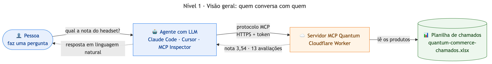
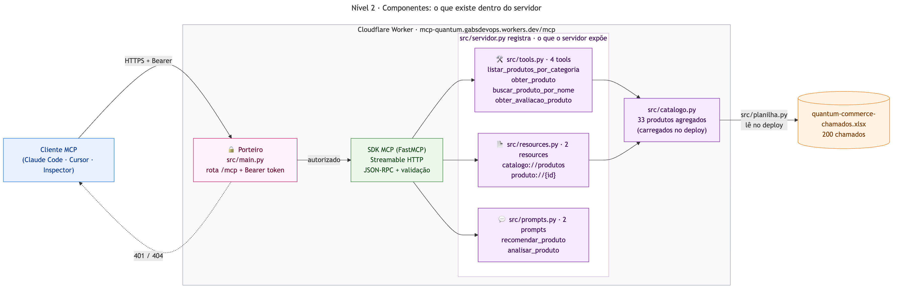
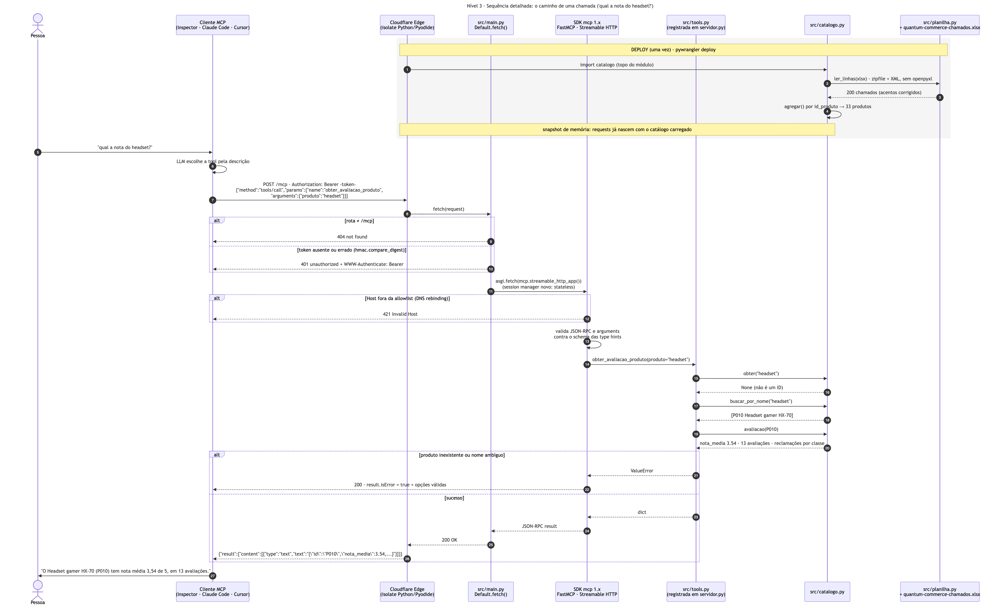

# MCP Quantum — catálogo de produtos

Servidor MCP do desafio Quantum (Integration Architecture & Connectors). Feito com
FastMCP (SDK oficial `mcp` 1.x), roda como **Cloudflare Python Worker** no plano free,
com transporte **Streamable HTTP** e Bearer token. O mesmo código roda localmente via
stdio.

Produção: `https://mcp-quantum.gabsdevops.workers.dev/mcp`

## Arquitetura em três níveis

Do mais geral para o mais detalhado. Fontes em Mermaid (`diagramas/*.mmd`), com o PNG ao lado.

**Nível 1 · Visão geral.** Quem conversa com quem, sem detalhe técnico.



**Nível 2 · Componentes.** O que existe dentro do Worker e o que o servidor expõe.



**Nível 3 · Sequência detalhada.** Uma chamada real passo a passo, do deploy à resposta,
com os desvios de erro (404, 401, 421, `isError`).



Para regerar os PNGs:

```bash
for f in diagramas/*.mmd; do
  npx @mermaid-js/mermaid-cli -i "$f" -o "${f%.mmd}.png" -w 1800 -s 2 -b white
done
```

## O que o servidor expõe

| Tipo | Nome | Arquivo | Item do desafio |
|---|---|---|---|
| tool | `listar_produtos_por_categoria(categoria)` | `src/tools.py` | 1. listar produtos por categoria |
| tool | `obter_produto(produto_id)` | `src/tools.py` | 2. dados do produto pelo ID |
| tool | `buscar_produto_por_nome(nome)` | `src/tools.py` | 3. busca pelo nome |
| tool | `obter_avaliacao_produto(produto)` | `src/tools.py` | 4. nota de avaliação (aceita ID ou nome) |
| resource | `catalogo://produtos` | `src/resources.py` | catálogo completo (JSON) |
| resource template | `produto://{produto_id}` | `src/resources.py` | detalhe do produto |
| prompt | `recomendar_produto(necessidade, orcamento?, categoria?)` | `src/prompts.py` | recomendação |
| prompt | `analisar_produto(produto_id)` | `src/prompts.py` | análise de custo-benefício |

Cada arquivo tem um `registrar(mcp)`; o `src/servidor.py` cria o FastMCP e chama os três.

Buscas ignoram acento e maiúsculas (`GAME` acha `game`, `pelucia` acha `Pelúcia`). Entradas
inválidas voltam como erro de tool (`isError: true`) com a lista de opções válidas.

## Dados

A única fonte é a planilha `src/quantum-commerce-chamados.xlsx`, sem etapa de geração:
**200 reclamações** de clientes de um marketplace, com os dados do produto repetidos em
cada linha. O Worker empacota o `.xlsx` (regra `Data` no `wrangler.jsonc`) e o
`src/catalogo.py` lê a planilha no import, com `src/planilha.py` (só `zipfile` + XML da
biblioteca padrão, sem `openpyxl`, para não pesar no bundle). Na leitura, a acentuação é
corrigida (a planilha veio com UTF-8 lido como Latin-1, `Preço`) e os dados são
agregados por `id_produto`:

| Campo | Na planilha | No catálogo |
|---|---|---|
| nome, descrição, categoria | fixos por produto | iguais |
| preço | varia por vendedor | `preco` = média, `preco_min`/`preco_max` = faixa |
| vendedor | vários por produto | lista `vendedores` |
| `avaliacao_produto` | uma nota por chamado | `nota` (média), `nota_min`/`nota_max`, `num_avaliacoes` |
| `classe` | tipo da reclamação | `reclamacoes_por_classe` |

Resultado: **33 produtos** em 5 categorias (`brinquedo`, `game`, `livro`, `maquiagem`,
`outros`). Como o import roda no deploy, o catálogo entra no snapshot de memória e nenhum
request paga o parse. Para trocar os dados, substitua o `.xlsx` e rode `pywrangler deploy`.

O `tests/test_dados.py` compara o leitor próprio com o `openpyxl` (dependência só de dev)
célula a célula e confere os agregados contra a planilha.

## Estrutura

```
src/quantum-commerce-chamados.xlsx  fonte única dos dados
src/planilha.py           leitor de .xlsx com a biblioteca padrão
src/catalogo.py           carga + agregação da planilha e consultas, Python puro
src/servidor.py           cria o FastMCP (transporte, segurança) e registra as capacidades
src/tools.py              as 4 tools
src/resources.py          os 2 resources (catálogo + template por ID)
src/prompts.py            os 2 prompts
src/main.py               entrypoint do Worker + checagem do Bearer token
src/local.py              mesmo servidor via stdio/HTTP local
scripts/inspector.sh      MCP Inspector já apontado para cloudflare, local ou stdio
tests/                    unitários, consistência com a planilha e E2E em produção
diagramas/                arquitetura em 3 níveis (Mermaid .mmd + PNG)
evidencias/               saídas de teste, prints do Inspector, Claude Code e Cursor
```

## Rodar

Pré-requisitos: `uv` >= 0.12.3 (exigido pelo `pywrangler`) e Node (para `npx`).

```bash
uv sync
uv run pytest -q                                  # 20 testes (E2E é pulado sem MCP_URL)

# Worker local (porta 8787), com auth
echo "MCP_TOKEN=$(openssl rand -hex 24)" > .dev.vars
uv run pywrangler dev
```

## MCP Inspector (reproduzível)

`scripts/inspector.sh` sobe o Inspector (versão fixada, 2.11.0) já com o servidor, a URL e o
header de auth configurados. É só clicar em conectar.

```bash
scripts/inspector.sh cloudflare     # produção; lê o token de .token
scripts/inspector.sh local          # Worker do `pywrangler dev`; lê o token de .dev.vars
scripts/inspector.sh stdio          # servidor Python direto (src/local.py), sem auth

scripts/inspector.sh cloudflare check   # sem UI: lista tools/resources/prompts e chama uma tool
```

O alvo `local` exige o `uv run pywrangler dev` rodando em outro terminal. O token vai como
argumento do processo do Inspector, então só use em máquina própria.

## Deploy na Cloudflare

```bash
npx wrangler login
uv run pywrangler deploy
openssl rand -hex 24 | tee .token | npx wrangler secret put MCP_TOKEN
```


## Testes e evidências

```bash
uv run pytest -q                                                    # unitários + dados
MCP_URL=https://mcp-quantum.gabsdevops.workers.dev/mcp MCP_TOKEN=$(cat .token) \
  uv run pytest tests/test_e2e.py -v                                # cliente MCP real em produção
```

Config usada pelos clientes (Claude Code em `--mcp-config`, Cursor em `.cursor/mcp.json`):

```json
{"mcpServers": {"quantum": {"type": "http",
  "url": "https://mcp-quantum.gabsdevops.workers.dev/mcp",
  "headers": {"Authorization": "Bearer <token>"}}}}
```

| Arquivo | O que prova |
|---|---|
| `01-pytest-unitario.txt` | 20 testes: 4 tools, resources, prompts, erros, leitor x openpyxl e agregados x planilha |
| `02-pytest-e2e-producao.txt` | 11 testes com `ClientSession` do SDK contra a URL publicada (401, 404, tools, resources, prompt) |
| `03-inspector-sem-token-401.png` | sem header de auth o Inspector não conecta |
| `04-inspector-conectado.png` | conectado em produção, MCP 2025-11-25 |
| `05` a `08` | tools 1 a 4 executadas no Inspector |
| `09-resource-catalogo-completo.png` | resource `catalogo://produtos` |
| `10-resource-template-produto.png` | resource template `produto://P015` |
| `11-prompt-recomendar-produto.png` | prompt `recomendar_produto` com argumentos |
| `12-claude-code-oneshot.md` | `claude -p` usando as 4 tools + prompt como slash command |
| `13-cursor-oneshot.md` | `cursor-agent -p` usando as tools |
| `14-inspector-script-cloudflare.png` | `scripts/inspector.sh cloudflare` abre já conectado em produção |

## Segurança (o mínimo que dá pra defender)

- **Bearer token** em `wrangler secret` (nunca no código), comparado com
  `hmac.compare_digest` antes de chegar no MCP. Sem token: `401` com `WWW-Authenticate`.
- **Só `/mcp` existe**; qualquer outra rota responde `404`.
- **Proteção contra DNS rebinding** do SDK ligada, com allowlist de `Host`/`Origin`.
- **Somente leitura**: nenhuma tool altera estado; a planilha vai empacotada no bundle.
- Fora do escopo: OAuth por usuário, rate limiting e rotação automática do token.

## Por que essa combinação de versões

Testei com deploy real antes de fechar (plano free: 3 MB de bundle, CPU limitada):

| Tentativa | Resultado |
|---|---|
| `fastmcp` standalone | 9,5 MB gzip (puxa `cryptography`, `beartype`, `authlib`) — não cabe |
| `mcp` 2.x | importa `cryptography` no topo do módulo — não cabe |
| `mcp` 1.x + override `pyjwt` sem `[crypto]` | **2,8 MB gzip** — cabe (2,88 MB com a planilha) |
| import dentro do `fetch` | 2010 ms de CPU no cold start → erro `1102` |
| import no topo (snapshot de memória do deploy) | 13–37 ms de CPU com isolate quente, ~650 ms no cold start, `outcome: ok` |

O consumo de CPU passa dos 10 ms nominais do free e a Cloudflare tem tolerado; sob
carga pode aparecer `1102`. Para uso real, o plano pago (US$ 5/mês) resolve.
