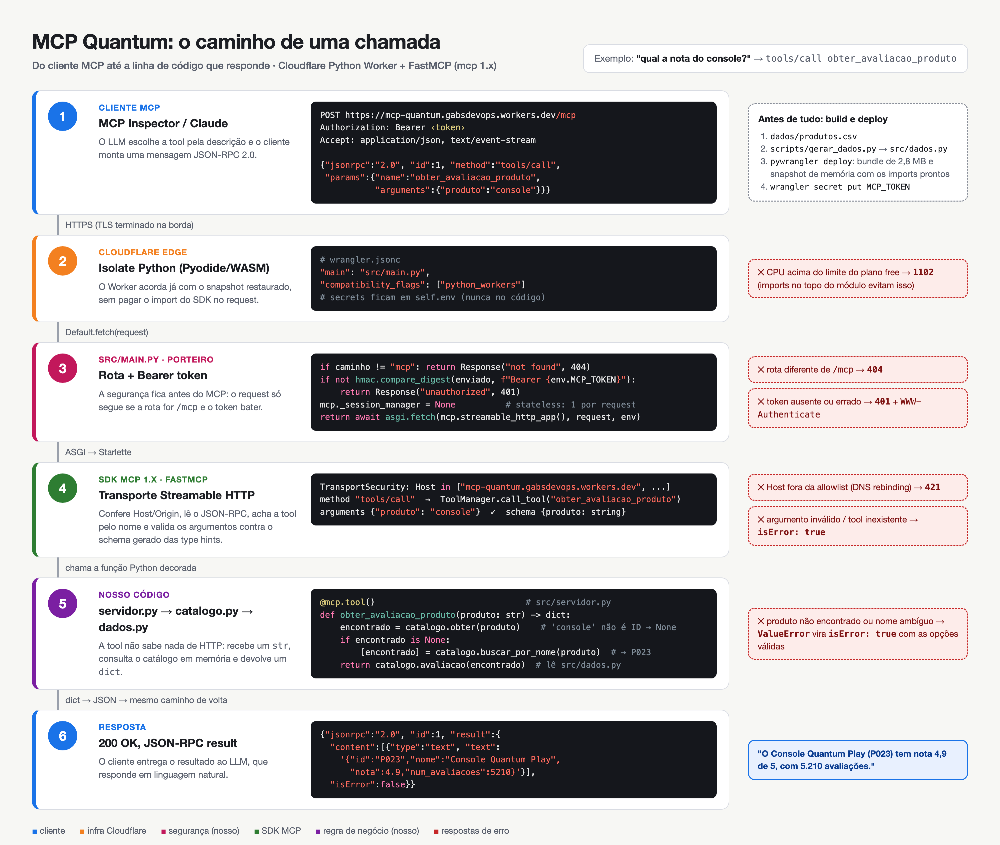

# MCP Quantum — catálogo de produtos

Servidor MCP do desafio Quantum (Integration Architecture & Connectors). Feito com
FastMCP (SDK oficial `mcp` 1.x), roda como **Cloudflare Python Worker** no plano free,
com transporte **Streamable HTTP** e Bearer token. O mesmo código roda localmente via
stdio.

Produção: `https://mcp-quantum.gabsdevops.workers.dev/mcp`

## Como uma chamada percorre o sistema



Fonte editável: `diagramas/fluxo-chamada.html` (exportado com Chrome headless, 2x).

## O que o servidor expõe

| Tipo | Nome | Item do desafio |
|---|---|---|
| tool | `listar_produtos_por_categoria(categoria)` | 1. listar produtos por categoria |
| tool | `obter_produto(produto_id)` | 2. dados do produto pelo ID |
| tool | `buscar_produto_por_nome(nome)` | 3. busca pelo nome |
| tool | `obter_avaliacao_produto(produto)` | 4. nota de avaliação (aceita ID ou nome) |
| resource | `catalogo://produtos` | catálogo completo (JSON) |
| resource template | `produto://{produto_id}` | detalhe do produto |
| prompt | `recomendar_produto(necessidade, orcamento?, categoria?)` | recomendação |
| prompt | `analisar_produto(produto_id)` | análise de custo-benefício |

Buscas ignoram acento e maiúsculas (`informatica` acha `Informática`). Entradas
inválidas voltam como erro de tool (`isError: true`) com a lista de opções válidas.

## Estrutura

```
dados/produtos.csv        fonte dos dados
scripts/gerar_dados.py    CSV -> src/dados.py (o Worker não lê arquivo do disco)
src/catalogo.py           consultas, Python puro
src/servidor.py           tools, resources e prompts (FastMCP)
src/main.py               entrypoint do Worker + checagem do Bearer token
src/local.py              mesmo servidor via stdio/HTTP local
tests/                    pytest in-process
diagramas/                fluxo da chamada (HTML + PNG)
evidencias/               prints do MCP Inspector
```

## Rodar

Pré-requisitos: `uv` >= 0.12.3 (exigido pelo `pywrangler`) e Node (para `npx`).

```bash
uv sync
uv run pytest -q                                  # 10 testes

# Trocar a fonte de dados (aceita , ; ou tab e nomes de coluna em PT/EN)
uv run python scripts/gerar_dados.py caminho/do/arquivo.csv

# Local via stdio, sem auth
npx @modelcontextprotocol/inspector uv run python src/local.py

# Worker local (porta 8787), com auth
echo "MCP_TOKEN=$(openssl rand -hex 24)" > .dev.vars
uv run pywrangler dev
```

## Deploy na Cloudflare

```bash
npx wrangler login
uv run pywrangler deploy
openssl rand -hex 24 | tee .token | npx wrangler secret put MCP_TOKEN
```

No Inspector: Transport `Streamable HTTP`, URL `https://mcp-quantum.gabsdevops.workers.dev/mcp`,
Authentication → Bearer Token com o conteúdo de `.token`.

## Segurança (o mínimo que dá pra defender)

- **Bearer token** em `wrangler secret` (nunca no código), comparado com
  `hmac.compare_digest` antes de chegar no MCP. Sem token: `401` com `WWW-Authenticate`.
- **Só `/mcp` existe**; qualquer outra rota responde `404`.
- **Proteção contra DNS rebinding** do SDK ligada, com allowlist de `Host`/`Origin`.
- **Somente leitura**: nenhuma tool altera estado; o catálogo é embutido no bundle.
- Fora do escopo: OAuth por usuário, rate limiting e rotação automática do token.

## Por que essa combinação de versões

Testei com deploy real antes de fechar (plano free: 3 MB de bundle, CPU limitada):

| Tentativa | Resultado |
|---|---|
| `fastmcp` standalone | 9,5 MB gzip (puxa `cryptography`, `beartype`, `authlib`) — não cabe |
| `mcp` 2.x | importa `cryptography` no topo do módulo — não cabe |
| `mcp` 1.x + override `pyjwt` sem `[crypto]` | **2,8 MB gzip** — cabe |
| import dentro do `fetch` | 2010 ms de CPU no cold start → erro `1102` |
| import no topo (snapshot de memória do deploy) | 68–750 ms de CPU, `outcome: ok` |

O consumo de CPU passa dos 10 ms nominais do free e a Cloudflare tem tolerado; sob
carga pode aparecer `1102`. Para uso real, o plano pago (US$ 5/mês) resolve.
